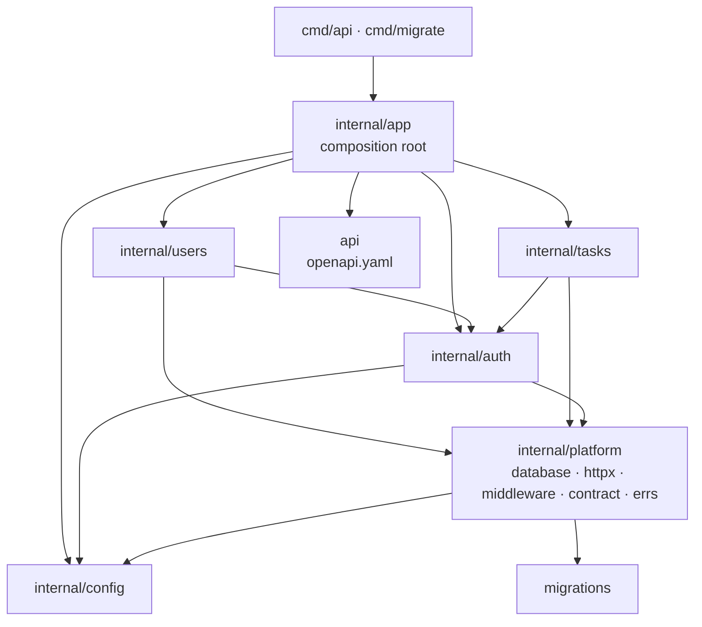
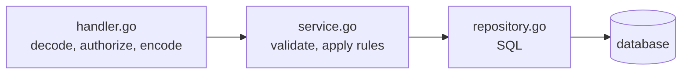

# Architecture

The code is organised in **feature packages** on top of a small **platform layer**, wired
together in one place.



## Packages

| Package | Responsibility |
|---|---|
| `cmd/api` | Entry point of the server. Parses flags, loads the configuration, runs the application. |
| `cmd/migrate` | Entry point of the migration command: `up`, `down`, `status`. |
| `api` | The OpenAPI document, embedded with `go:embed`. |
| `migrations` | The SQL migrations, one directory per driver, embedded. |
| `internal/app` | The composition root. `app.go` constructs every component; `routes.go` builds the router. |
| `internal/app/apptest` | Starts the whole application for end-to-end tests. |
| `internal/config` | Declares, loads and validates every environment variable. |
| `internal/auth` | Password hashing, access and refresh tokens, the authentication middleware and the `/auth` endpoints. |
| `internal/users` | The users feature: model, service, repository, handler. |
| `internal/tasks` | The example feature, and the source the resource generator copies. |
| `internal/platform/database` | Connection, driver registry, placeholder rewriting, transactions, migrations. |
| `internal/platform/httpx` | The HTTP conventions: JSON, problem responses, pagination, `ETag`. |
| `internal/platform/middleware` | Request ID, logging, recovery, security headers, metrics, rate limiting. |
| `internal/platform/contract` | Loads the OpenAPI document and validates traffic against it. |
| `internal/platform/errs` | Application errors with stable codes, independent of HTTP. |
| `internal/platform/logging` | Builds the logger and carries a request-scoped logger in the context. |
| `internal/platform/tracing` | OpenTelemetry setup. |
| `internal/platform/version` | Build metadata. |

## Rules

**A feature owns everything about its resource.** `internal/tasks` has four files: the
model (`task.go`), the business rules (`service.go`), the SQL (`repository.go`) and the
HTTP endpoints (`handler.go`). Deleting the directory deletes the feature; the only other
places that mention it are the composition root, its migration and its part of the
OpenAPI document.

**Features do not import each other.** `users` and `tasks` depend on `auth` and on the
platform, never on one another. A task belongs to a user through a foreign key; when the
owner does not exist, the database rejects the insert and the repository reports it as
invalid input. There is no call from `tasks` into `users`.

**`auth` does not know how users are stored.** It declares the interface it needs and
`users.Service` implements it:

```go
// UserDirectory is what authentication needs to know about users.
type UserDirectory interface {
	// Authenticate verifies a username and password.
	Authenticate(ctx context.Context, username string, password string) (Identity, error)
	// Identity returns the current identity of a user. It is called on every
	// authenticated request, so role changes and deletions apply immediately.
	Identity(ctx context.Context, userID int64) (Identity, error)
}
```

This keeps the import direction `users → auth` and makes the middleware testable with an
in-memory directory.

**Services depend on interfaces they declare.** Each service defines the `Store` it needs
next to its own code; the repository satisfies it. The service does not import
`database/sql`.

**Only `internal/app` knows every package.** Construction happens in `app.New` and routing
in `routes()`. Nothing registers itself through `init` functions, with one exception: each
database driver registers itself in the driver registry, so that removing a backend is
removing a file.

**Errors carry a code, not a status.** Services and repositories return `errs` values such
as `errs.NotFound`. The mapping to HTTP statuses lives in `httpx`. See [Errors](errors.md).

**The contract is the source of truth.** `api/openapi.yaml` is validated at startup, served
at `/openapi.yaml`, used to validate requests, and compared with the router by a test. See
[API conventions](../guides/api-conventions.md).

## Layers inside a feature



| Layer | Does | Does not |
|---|---|---|
| Handler | Reads path, query and body; checks who the caller is and what they may touch; writes JSON, `ETag` and errors. | Contain business rules or SQL. |
| Service | Normalises and validates input, applies the rules of the resource. | Know about HTTP or about the caller's role. |
| Repository | Runs SQL and maps driver errors to application errors. | Decide anything. |

Authorization sits in the handler because it depends on the caller, which is an HTTP
concern here. A handler loads the resource, calls `Identity.Authorize(ownerID)` and only
then passes the resource to the service.

## Lifecycle of the process

1. `cmd/api` loads the configuration. Every invalid variable is reported and the process
   exits before doing anything else.
2. `app.New` sets up tracing when enabled, opens the database, applies migrations when
   `DATABASE_AUTO_MIGRATE` is true, builds the components, creates the bootstrap
   administrator when configured, and loads the contract.
3. `App.Run` starts the API server and, unless `ADMIN_PORT=0`, the admin server.
4. On `SIGINT` or `SIGTERM`, readiness starts failing, both servers stop accepting
   connections and wait for in-flight requests up to `APP_SHUTDOWN_TIMEOUT`, and the
   database and the tracer are closed.
