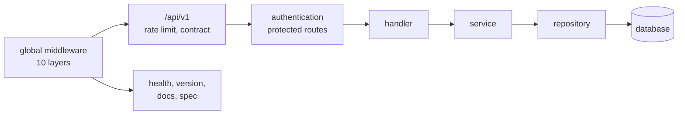

# Request lifecycle

Every request crosses the same middleware, in the order set in `internal/app/routes.go`.
The order is deliberate: each layer relies on the ones before it.



## Global middleware

These wrap every route, including the health endpoints.

| # | Middleware | What it does | Why it is here |
|---|---|---|---|
| 1 | Request ID | Reuses the `X-Request-ID` sent by the client when it is at most 64 characters of letters, digits, `-`, `_` and `.`; otherwise generates one. Echoes it in the response. | First, so that everything after it can log and report the identifier. |
| 2 | Client IP | Resolves the caller's address. With `HTTP_TRUSTED_PROXIES=0` it is the TCP peer; with `n` it is the `X-Forwarded-For` entry added by the outermost of `n` trusted proxies. | Before logging and rate limiting, which both use it. |
| 3 | Tracing | Starts a server span and reads the incoming trace context. Only when `OTEL_ENABLED=true`. | Early, so the span covers the rest of the stack. |
| 4 | Logger | Puts a logger carrying `request_id` into the context and writes one record when the request ends. | Before recovery, so a recovered panic still produces a normal access record with status 500. |
| 5 | Recover | Turns a panic into a 500 problem response and logs the stack trace. | Inside the logger and outside everything that can panic. |
| 6 | Metrics | Counts the request, observes its duration and tracks in-flight requests. Only when `METRICS_ENABLED=true`. | Outside the layers that reject requests, so rejected requests are counted too. |
| 7 | Security headers | Sets `X-Content-Type-Options`, `X-Frame-Options`, `Referrer-Policy` and `Cross-Origin-Resource-Policy`, plus `Strict-Transport-Security` when the request arrived over TLS or with `X-Forwarded-Proto: https`. | Before anything that writes a response, so errors carry them as well. |
| 8 | CORS | Answers preflight requests and sets the CORS headers for the origins in `HTTP_CORS_ALLOWED_ORIGINS`. | Before authentication: preflight requests carry no credentials. |
| 9 | Body limit | Caps the request body at `HTTP_MAX_BODY_BYTES`. | Before anything reads the body. |
| 10 | Timeout | Gives the request context a deadline of `HTTP_REQUEST_TIMEOUT`. | Innermost, so the deadline covers validation, the handler and the database calls. |

Unmatched paths and methods are answered by `middleware.NotFound` and
`middleware.MethodNotAllowed`, so they use the problem format too.

## The versioned API

Routes under `/api/v1` add two layers.

**Rate limit.** `RATE_LIMIT_REQUESTS` per `RATE_LIMIT_WINDOW` and client IP. The
authentication endpoints (`/auth/login`, `/auth/refresh`, `/auth/logout`) additionally get
the smaller `RATE_LIMIT_LOGIN_REQUESTS` budget. A request over the limit gets 429 with the
code `rate_limited`. Responses carry `X-RateLimit-Limit`, `X-RateLimit-Remaining` and
`X-RateLimit-Reset`.

!!! warning "The counters are per process"

    They live in memory. With several replicas each one enforces its own budget, so the
    effective limit is the configured one times the number of replicas. For a global
    limit, enforce it at the gateway or change `middleware.RateLimit` to use a shared
    counter.

**Contract validation.** The request is matched against the OpenAPI document. Path and
query parameters and the body are validated; a mismatch is answered with 400 and the
offending field. When `OPENAPI_VALIDATE_RESPONSES=true` the response is buffered and
validated as well; a response that does not match the document is replaced by a 500 and
logged. That is the default in development and in the tests, and off in production. A
request for a path the document does not describe is passed on untouched, so the router
answers it with 404 or 405.

## Authentication

Authentication is not global. Each feature decides which of its routes are protected:

```go
func (h *Handler) Routes(r chi.Router, authn *auth.Middleware) {
	r.Group(func(r chi.Router) {
		r.Use(authn.Authenticate)

		r.Get("/tasks", h.list)
		r.Post("/tasks", h.create)
		r.Get("/tasks/{taskID}", h.get)
		r.Patch("/tasks/{taskID}", h.update)
		r.Delete("/tasks/{taskID}", h.delete)
	})
}
```

`Authenticate` verifies the bearer token, loads the caller from the user directory and
stores the identity in the context. Handlers read it with `auth.MustIdentity`.
`auth.RequireRole` restricts a group to some roles. See
[Authentication and authorization](../guides/authentication.md).

## Handler, service, repository

A handler follows the same steps for every write:

```go
func (h *Handler) update(w http.ResponseWriter, r *http.Request) {
	current, err := h.load(r) // path ID, fetch, authorize
	if err != nil {
		httpx.WriteError(w, r, err)
		return
	}

	if err := httpx.CheckIfMatch(r, current.Version); err != nil {
		httpx.WriteError(w, r, err)
		return
	}

	var input UpdateInput
	if err := httpx.DecodeJSON(r, &input); err != nil {
		httpx.WriteError(w, r, err)
		return
	}

	updated, err := h.service.Update(r.Context(), current, input)
	if err != nil {
		httpx.WriteError(w, r, err)
		return
	}

	httpx.SetETag(w, updated.Version)
	httpx.WriteJSON(w, http.StatusOK, updated)
}
```

Every failure goes through `httpx.WriteError`, which is the only place that turns an error
into a response.

## The response

On the way back, each layer finishes its work in reverse order: the contract validates the
response when enabled, the metrics middleware records the status and the duration, and the
logger writes the access record:

```text
level=INFO msg="http request" request_id=4XNLTPQRWYGPJKHSFWW6OHH6ZP method=GET path=/health/live route=/health/live status=200 bytes=16 duration=115.789µs client_ip=::1
```

The level follows the status: `INFO` below 400, `WARN` for 4xx and `ERROR` for 5xx.

## The admin server

Metrics and profiling are served by a second HTTP server on `ADMIN_PORT` (9090), with none
of the middleware above and no authentication. It exposes `/health/live`, `/metrics` when
metrics are enabled, and `/debug/pprof/` when `ADMIN_PPROF_ENABLED=true`. Keep it off the
public network. See [Observability](../guides/observability.md).
