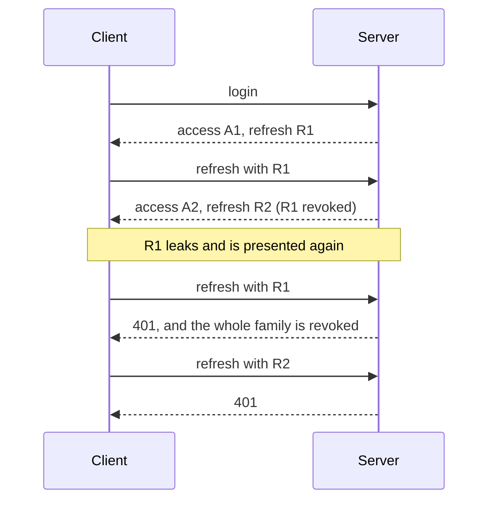

# Authentication and authorization

Authentication lives in `internal/auth`. It issues two tokens at login, verifies the
access token on protected routes, and reloads the caller from the database on every
request.

## Tokens

| | Access token | Refresh token |
|---|---|---|
| Format | JWT, signed with HS256 or EdDSA | 52 random characters |
| Lifetime | `AUTH_ACCESS_TOKEN_TTL`, 15 minutes | `AUTH_REFRESH_TOKEN_TTL`, 720 hours |
| Sent as | `Authorization: Bearer <token>` | In the body of `/auth/refresh` and `/auth/logout` |
| Stored by the server | No | Only its SHA-256 hash |
| Can be revoked | Not individually; it expires | Yes |

The access token carries `sub` (the user identifier), `role`, `iss`, `iat` and `exp`. The
`role` claim is informational: the server never trusts it (see below).

## Endpoints

| Endpoint | Body | Result |
|---|---|---|
| `POST /api/v1/auth/login` | `{"username", "password"}` | A token pair |
| `POST /api/v1/auth/refresh` | `{"refresh_token"}` | A new token pair |
| `POST /api/v1/auth/logout` | `{"refresh_token"}` | 204 |

```json
{
  "access_token": "eyJhbGciOiJIUzI1NiIsInR5cCI6IkpXVCJ9...",
  "refresh_token": "...",
  "token_type": "Bearer",
  "expires_in": 900
}
```

These three endpoints are public and share a stricter rate limit,
`RATE_LIMIT_LOGIN_REQUESTS` per window and client IP.

## Refresh token rotation

A refresh token works **once**. Each `/auth/refresh` call revokes the token it receives
and returns a new one. All tokens descended from the same login form a **family**.



Presenting a token that was already used means two parties hold it. The server cannot tell
which one is legitimate, so it revokes the family and the user has to log in again. The
lookup, the revocation and the creation of the new token run in one database transaction.

`/auth/logout` revokes the family of the token it is given. It answers 204 for unknown
tokens too, so it does not reveal whether a token exists. Access tokens already issued stay
valid until they expire, which is why they are short-lived.

Expired refresh tokens of a user are deleted when that user logs in.

## The caller is reloaded on every request

`Middleware.Authenticate` does three things:

1. Verifies the signature, the issuer and the expiry of the access token.
2. Loads the user named in `sub` through the `UserDirectory`.
3. Stores the resulting `auth.Identity` in the request context.

Step 2 costs one indexed query per authenticated request. In exchange, **deleting a user or
changing their role takes effect immediately**, not when the token expires: a deleted user
gets 401 on the next request, and a promoted user gains the new role with the token they
already hold. If that query matters for your load, cache the identity for a few seconds in
your `UserDirectory`; do not skip the lookup.

## Protecting routes

A feature receives the middleware and decides what to protect:

```go
func (h *Handler) Routes(r chi.Router, authn *auth.Middleware) {
	r.Group(func(r chi.Router) {
		r.Use(authn.Authenticate)

		r.Get("/users/me", h.me)
		r.Get("/users/{userID}", h.get)

		r.Group(func(r chi.Router) {
			r.Use(auth.RequireRole(auth.RoleAdmin))
			r.Get("/users", h.list)
		})
	})
}
```

Inside a handler:

```go
caller := auth.MustIdentity(r.Context()) // UserID, Username, Role

if err := caller.Authorize(task.UserID); err != nil {
	// neither the owner nor an administrator
}
```

- `auth.MustIdentity` returns the caller. It panics when the route is not behind
  `Authenticate`, which is a wiring mistake that the recovery middleware turns into a 500.
- `Identity.Authorize(ownerID)` allows the owner and administrators.
- `Identity.IsAdmin()` is for rules that differ by role, such as listing everyone's tasks.

## Roles

There are two roles, `admin` and `user`, defined in `internal/auth/identity.go` and
enforced by a `CHECK` constraint in the `users` table.

| Action | `user` | `admin` |
|---|---|---|
| Read, update, delete their own account | Yes | Yes |
| Read, update, delete another account | No | Yes |
| List users | No | Yes |
| Change a role | No | Yes |
| Manage their own tasks | Yes | Yes |
| See and manage every task, create tasks for others | No | Yes |

To add a role, add the constant, extend `Role.Valid`, update the `CHECK` constraint with a
migration and add the value to the `Role` schema in the OpenAPI document.

## Registration and the first administrator

`AUTH_REGISTRATION_ENABLED` (default `true`) controls `POST /api/v1/users`:

- **Enabled:** the endpoint is public and creates accounts with the `user` role. Asking for
  another role is refused with 403.
- **Disabled:** the endpoint requires an administrator, who may assign any role.

The first administrator comes from the environment. With `BOOTSTRAP_ADMIN_ENABLED=true`, an
administrator is created at startup from the `BOOTSTRAP_ADMIN_*` variables **if no
administrator exists**. Once one exists the variables are ignored, so they can stay set.
The password must be at least 12 characters.

## Passwords

- Hashed with bcrypt at cost `AUTH_BCRYPT_COST` (default 12, allowed 10 to 16).
- At least 8 characters and at most 72 **bytes**. bcrypt ignores everything after 72 bytes,
  so longer passwords are rejected rather than silently truncated.
- Not trimmed or normalised: spaces are significant.
- A login with an unknown username still spends the time of one bcrypt comparison, so
  response time does not reveal which usernames exist. Both cases return the same
  `invalid credentials` error.

Usernames are trimmed and lowercased, and must be at least 3 characters.

## Signing algorithm

=== "HS256 (default)"

    One shared secret signs and verifies. Simple, and enough when this service is the only
    one that verifies its tokens.

    ```sh
    AUTH_ALGORITHM=HS256
    AUTH_SECRET=$(openssl rand -base64 48)
    ```

    In production the server refuses to start with the default secret or with one shorter
    than 32 characters.

=== "EdDSA"

    An Ed25519 private key signs; the public key verifies. Other services can verify tokens
    without being able to issue them.

    ```sh
    openssl genpkey -algorithm ed25519 -out auth-key.pem

    AUTH_ALGORITHM=EdDSA
    AUTH_PRIVATE_KEY_FILE=/run/secrets/auth-key.pem
    ```

    The file must be a PEM-encoded PKCS#8 key, which is what `openssl genpkey` writes. The
    public key is published as a JWK set:

    ```sh
    curl -s localhost:8080/.well-known/jwks.json
    ```

    ```json
    {"keys":[{"alg":"EdDSA","crv":"Ed25519","kid":"...","kty":"OKP","use":"sig","x":"..."}]}
    ```

    Tokens carry the `kid` of the key in their header. The endpoint does not exist with
    HS256.

The verifier accepts only the configured algorithm. A token signed with another one,
including `none`, is rejected.

There is no key rotation: one key is active at a time, and changing it invalidates the
access tokens already issued. Refresh tokens are not signed and survive a key change.

## Changing the model

| To | Change |
|---|---|
| Add claims | `claims` and `Signer.Issue` in `internal/auth/signer.go` |
| Use an external identity provider | Replace `Signer.Verify` with a verifier for its tokens and keep `UserDirectory.Identity` to map subjects to local users |
| Cache identities | Wrap `users.Service` in a `UserDirectory` that caches `Identity` |
| Drop refresh tokens | Remove `Service.Refresh`, the route and the `refresh_tokens` table, and raise the access token lifetime |
